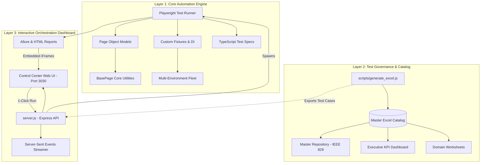

# Enterprise E2E Test Automation & Orchestrator Framework Blueprint

> **Complete architectural blueprint, technology stack inventory, and step-by-step replication guide.**  
> Use this document to bootstrap, configure, and execute an identical test automation framework and interactive control center for any enterprise web application.

---

## 📑 Table of Contents

1. [Executive Architecture Overview](#1-executive-architecture-overview)
2. [Technology Stack & Dependency Inventory](#2-technology-stack--dependency-inventory)
3. [Directory Structure & File Anatomy](#3-directory-structure--file-anatomy)
4. [Core Architectural Patterns](#4-core-architectural-patterns)
   - [4.1 Page Object Model (POM) & BasePage](#41-page-object-model-pom--basepage)
   - [4.2 Custom Test Fixtures & Dependency Injection](#42-custom-test-fixtures--dependency-injection)
   - [4.3 Multi-Environment Fleet Management](#43-multi-environment-fleet-management)
   - [4.4 Enterprise Excel Test Catalog Engine (IEEE-829)](#44-enterprise-excel-test-catalog-engine-ieee-829)
   - [4.5 Interactive Web Control Dashboard & SSE Runner](#45-interactive-web-control-dashboard--sse-runner)
   - [4.6 Enterprise Assertions & Validation Design](#46-enterprise-assertions--validation-design)
5. [Step-by-Step Guide: Replicating for a New Project](#5-step-by-step-guide-replicating-for-a-new-project)
   - [Step 1: Project Initialization & Package Setup](#step-1-project-initialization--package-setup)
   - [Step 2: TypeScript & Playwright Configuration](#step-2-typescript--playwright-configuration)
   - [Step 3: Environment Configuration & Secret Management](#step-3-environment-configuration--secret-management)
   - [Step 4: Logging & Test Data Generators](#step-4-logging--test-data-generators)
   - [Step 5: BasePage & Domain Page Objects](#step-5-basepage--domain-page-objects)
   - [Step 6: Fixtures Setup (`baseTest.ts`)](#step-6-fixtures-setup-basetestts)
   - [Step 7: Excel Test Catalog Generator](#step-7-excel-test-catalog-generator)
   - [Step 8: Interactive Express Server & Live SSE Streaming](#step-8-interactive-express-server--live-sse-streaming)
   - [Step 9: Interactive Control Center Web Interface](#step-9-interactive-control-center-web-interface)
   - [Step 10: Writing Automated Test Specs](#step-10-writing-automated-test-specs)
6. [Critical Gotchas & Engineering Best Practices](#6-critical-gotchas--engineering-best-practices)
7. [NPM Scripts & CI/CD Pipeline Integration](#7-npm-scripts--cicd-pipeline-integration)

---

## 1. Executive Architecture Overview

This framework combines **three integrated systems** into a unified test engineering solution:



### Key Capabilities:
- **100% Traceability**: Every test case in the master Excel sheet has a direct 1-to-1 mapping with an automated test spec ID (`TC_MODULE_XXX`).
- **Dynamic Catalog Loading**: `server.js` dynamically imports test scenarios from the test generator script, eliminating duplicate maintenance.
- **Real-Time Execution Streaming**: Web UI streams live test execution stdout/stderr line-by-line via Server-Sent Events (SSE).
- **Embedded Multi-Report Analytics**: Instant access to Allure HTML reports, Playwright HTML reports, execution logs, and Excel downloads.
- **Enterprise-Grade Assertions**: Zero silent passes; every spec enforces strict UI visibility, input reflection, state transitions, and error guardrails.

---

## 2. Technology Stack & Dependency Inventory

### Core Framework & Runtime
| Technology | Version | Purpose |
| :--- | :---: | :--- |
| **Node.js** | `>= 18.0.0` (v20+ recommended) | JavaScript/TypeScript runtime engine |
| **TypeScript** | `^5.7.0` | Strongly-typed OOP design and static compile safety |
| **Playwright Test** | `^1.50.0` | Cross-browser automated browser orchestration |
| **Express.js** | `^5.2.1` | REST API server and test execution daemon |
| **ExcelJS** | `^4.4.0` | Programmatic Excel workbook generation and styling |
| **dotenv** | `^16.4.7` | Zero-dependency environment variable loader |
| **Allure Playwright** | `^3.12.0` | Rich enterprise test reporting and telemetry |
| **Allure Commandline** | `^2.43.0` | CLI compiler for generating Allure HTML dashboards |
| **CORS** | `^2.8.6` | Cross-origin resource sharing middleware |

### `package.json` Specification:
```json
{
  "name": "portal-automation-framework",
  "version": "1.0.0",
  "description": "Enterprise End-to-End Test Automation Framework & Orchestrator",
  "main": "server.js",
  "scripts": {
    "app": "node server.js",
    "start": "node server.js",
    "test": "playwright test",
    "test:headed": "playwright test --headed",
    "test:ui": "playwright test --ui",
    "test:debug": "playwright test --debug",
    "test:report": "playwright show-report",
    "generate:excel": "node scripts/generate_excel.js",
    "typecheck": "tsc --noEmit"
  },
  "devDependencies": {
    "@playwright/test": "^1.50.0",
    "@types/node": "^22.10.0",
    "allure-commandline": "^2.43.0",
    "allure-playwright": "^3.12.0",
    "dotenv": "^16.4.7",
    "exceljs": "^4.4.0",
    "typescript": "^5.7.0"
  },
  "dependencies": {
    "cors": "^2.8.6",
    "express": "^5.2.1"
  }
}
```

---

## 3. Directory Structure & File Anatomy

```text
├── .env                                # Local secrets & active environment variables
├── .env.example                        # Template for environment configuration
├── .gitignore                          # Ignored artifacts (node_modules, reports, .env)
├── package.json                        # NPM package configuration & scripts
├── tsconfig.json                       # TypeScript compiler options
├── playwright.config.ts                # Master Playwright test runner configuration
├── server.js                           # Express web orchestrator & SSE execution server
│
├── public/                             # Control Center Web UI frontend
│   ├── index.html                      # Single-page control center application
│   ├── style.css                       # Modern glassmorphism CSS theme tokens
│   └── app.js                          # Client-side SSE listener & matrix renderer
│
├── src/                                # Core Framework Architecture
│   ├── config/
│   │   ├── environment.ts              # Multi-environment loader & typed interfaces
│   │   └── environments.json           # Environment definitions (SIT, UAT, PROD, Custom)
│   │
│   ├── fixtures/
│   │   └── baseTest.ts                 # Extended test runner with DI page objects & validators
│   │
│   ├── pages/                          # Page Object Models (POM)
│   │   ├── BasePage.ts                 # Abstract parent page with resilient web actions
│   │   ├── LoginPage.ts                # Authentication & Keycloak SSO page object
│   │   ├── DashboardPage.ts            # Analytics & navigation header page object
│   │   ├── NavigationMenu.ts           # Global mega-menu dropdown page object
│   │   └── [Domain]Page.ts             # Domain-specific page objects
│   │
│   └── utils/
│       ├── logger.ts                   # Structured ISO-timestamped console logger
│       ├── testData.ts                 # Dynamic faker/generator for unique test entities
│       └── configValidator.ts          # Pre-flight environment validation engine
│
├── tests/                              # Automated Test Suites
│   ├── config/
│   │   └── config_check.spec.ts        # Pre-flight health & configuration sanity tests
│   ├── auth/
│   │   └── login.spec.ts               # Authentication & access security test specs
│   ├── dashboard/
│   │   └── dashboard.spec.ts           # Dashboard, KPIs & analytics test specs
│   └── [domain]/
│       └── [domain].spec.ts            # Domain-specific test specs
│
├── scripts/                            # Auxiliary Governance Tools
│   ├── generate_excel.js               # Master IEEE-829 Excel catalog generator & scenario exporter
│   └── sync_excel_status.js            # Automated status synchronization tool
│
└── reports/                            # Generated Execution Reports
    ├── html-report/                    # Built-in Playwright HTML report
    ├── allure-results/                 # Raw Allure execution data
    ├── allure-report/                  # Compiled Allure interactive web report
    └── test-results.json               # JSON structured execution log
```

---

## 4. Core Architectural Patterns

### 4.1 Page Object Model (POM) & BasePage

`BasePage` serves as the foundation for all page objects, providing centralized error handling, explicit waiting, loading spinner dismissal, and robust input manipulation.

#### Key Methods in `BasePage.ts`:
```typescript
import { Page, Locator, expect } from '@playwright/test';
import { Logger } from '../utils/logger';

export abstract class BasePage {
  readonly page: Page;
  readonly loadingSpinner: Locator;

  constructor(page: Page) {
    this.page = page;
    this.loadingSpinner = page.locator('.loading-spinner, .MuiCircularProgress-root, [role="progressbar"]');
  }

  async waitForPageReady(timeout: number = 15000): Promise<void> {
    await this.page.waitForLoadState('domcontentloaded', { timeout });
    await this.waitForLoadingSpinnerToDisappear(timeout);
  }

  async waitForLoadingSpinnerToDisappear(timeout: number = 15000): Promise<void> {
    try {
      if (await this.loadingSpinner.first().isVisible({ timeout: 1500 })) {
        await this.loadingSpinner.first().waitFor({ state: 'hidden', timeout });
      }
    } catch {
      // Spinner was not present or already disappeared
    }
  }

  async click(locator: Locator, description: string): Promise<void> {
    Logger.info(`Clicking: ${description}`);
    await locator.waitFor({ state: 'visible' });
    await locator.click();
    await this.waitForLoadingSpinnerToDisappear();
  }

  async fill(locator: Locator, value: string, description: string): Promise<void> {
    Logger.info(`Filling ${description} with value: "${value}"`);
    await locator.waitFor({ state: 'visible' });
    await locator.fill(value);
  }
}
```

---

### 4.2 Custom Test Fixtures & Dependency Injection

Rather than manually instantiating page objects in every test, Playwright's fixture system injects initialized page objects and executes pre-flight configuration validations automatically:

```typescript
// src/fixtures/baseTest.ts
import { test as baseTest, expect } from '@playwright/test';
import { LoginPage } from '../pages/LoginPage';
import { DashboardPage } from '../pages/DashboardPage';
import { config } from '../config/environment';
import { ConfigValidator } from '../utils/configValidator';

export interface PageFixtures {
  loginPage: LoginPage;
  dashboardPage: DashboardPage;
  appConfig: typeof config;
  autoConfigCheck: void;
}

export const test = baseTest.extend<PageFixtures>({
  // Auto-executed on every single test
  autoConfigCheck: [
    async ({}, use, testInfo) => {
      ConfigValidator.assertValid(config, testInfo.title);
      testInfo.annotations.push({ type: 'Environment', description: config.environment });
      testInfo.annotations.push({ type: 'Target URL', description: config.baseUrl });
      await use();
    },
    { auto: true },
  ],

  loginPage: async ({ page }, use) => {
    await use(new LoginPage(page));
  },

  dashboardPage: async ({ page }, use) => {
    await use(new DashboardPage(page));
  },

  appConfig: async ({}, use) => {
    await use(config);
  },
});

export { expect };
```

---

### 4.3 Multi-Environment Fleet Management

Environments are defined in `src/config/environments.json` and loaded via `src/config/environment.ts`. The active environment can be switched dynamically via `.env` or the web dashboard.

#### `src/config/environments.json`:
```json
{
  "activeEnvironmentId": "sit-stg2",
  "environments": [
    {
      "id": "sit-stg2",
      "name": "SIT - System Integration",
      "category": "SIT",
      "baseUrl": "https://sit-portal.company.com",
      "description": "Primary test staging environment",
      "auth": {
        "username": "test_user_sit"
      },
      "isDefault": true
    },
    {
      "id": "uat-preprod",
      "name": "UAT - User Acceptance",
      "category": "UAT",
      "baseUrl": "https://uat-portal.company.com",
      "description": "Pre-production validation environment",
      "auth": {
        "username": "test_user_uat"
      }
    }
  ]
}
```

---

### 4.4 Enterprise Excel Test Catalog Engine (IEEE-829)

The script `scripts/generate_excel.js` uses `exceljs` to generate a master workbook containing:
1. **Executive Dashboard**: KPI summary cards (`Total Tests`, `Automated`, `Manual`, `Critical/High/Medium/Low`), priority distributions, and dynamic Excel formulas (`COUNTA`, `COUNTIF`).
2. **Master Test Cases Repository**: Single unified table containing all test cases with IEEE-829 columns:
   - `Test Case ID` (e.g. `TC_AUTH_001`)
   - `Domain / Module`
   - `Sub-Module`
   - `Test Case Title`
   - `Objective`
   - `Preconditions`
   - `Step-by-Step Actions`
   - `Test Data`
   - `Expected Result`
   - `Priority` (`Critical`, `High`, `Medium`, `Low`)
   - `Execution Type` (`Automated (Playwright)` vs `Manual`)
   - `Automation Spec Reference` (`tests/...spec.ts -> [TC_XXX]`)
   - `Status` (`Automated & Passed`, `Ready to Execute`)
   - `Worksheet Tab Link`
3. **12 Individual Domain Worksheets**: Filtered and styled per domain with frozen headers, AutoFilters, and status badges.
4. **Data Export for Server**: Exports the raw `testCases` array so `server.js` can import scenarios directly.

---

### 4.5 Interactive Web Control Dashboard & SSE Runner

`server.js` provides an Express web application featuring:
- **Server-Sent Events (SSE)**: Streams stdout/stderr from `playwright test` directly to the browser in real time without websockets or polling.
- **Dynamic Scenario Synchronization**: Imports test cases from `scripts/generate_excel.js` and serves them via `/api/scenarios`.
- **Safe Process Spawning**: Resolves `npx` platform-specifically (`process.platform === 'win32' ? 'npx.cmd' : 'npx'`) with clean arguments and without vulnerable `{ shell: true }` flags.
- **Embedded Report Viewing**: Serves Allure and Playwright HTML reports inside full-height iframes.

---

### 4.6 Enterprise Assertions & Validation Design

Every test case adheres to the **"Zero Silent Passes"** rule:
- **Explicit Element Visibility**: `await expect(locator).toBeVisible()`
- **Input State Reflection**: After filling an input, assert `await expect(locator).toHaveValue(expectedValue)`
- **Negative & Error Validations**: When submitting invalid input, assert that the error banner appears (`.Mui-error`, `[role="alert"]`) and protected routes are not accessed.
- **Dropdown & Popup Validations**: When clicking a dropdown, verify that the listbox/menu appears and closes on selection or `Escape`.
- **Security Guardrails**: Verify HTTPS protocol enforcement, session cookie `secure: true` flags, and resistance to SQL injection / XSS.

---

## 5. Step-by-Step Guide: Replicating for a New Project

Follow these 10 steps to recreate this exact framework for another application.

### Step 1: Project Initialization & Package Setup

Create a new directory and initialize the project:
```bash
mkdir my-portal-automation
cd my-portal-automation
npm init -y
```

Install production and developer dependencies:
```bash
# Production dependencies
npm install express cors

# Developer dependencies
npm install -D @playwright/test @types/node typescript dotenv exceljs allure-playwright allure-commandline

# Install Playwright browser binaries
npx playwright install --with-deps
```

---

### Step 2: TypeScript & Playwright Configuration

#### Create `tsconfig.json`:
```json
{
  "compilerOptions": {
    "target": "ES2022",
    "module": "CommonJS",
    "moduleResolution": "node",
    "strict": true,
    "esModuleInterop": true,
    "skipLibCheck": true,
    "forceConsistentCasingInFileNames": true,
    "resolveJsonModule": true,
    "outDir": "./dist"
  },
  "include": ["src/**/*", "tests/**/*", "playwright.config.ts"],
  "exclude": ["node_modules", "dist"]
}
```

#### Create `playwright.config.ts`:
```typescript
import { defineConfig, devices } from '@playwright/test';
import * as dotenv from 'dotenv';
import * as path from 'path';

dotenv.config({ path: path.resolve(__dirname, '.env') });

const BASE_URL = process.env.PORTAL_BASE_URL || 'https://my-portal.company.com';

export default defineConfig({
  testDir: './tests',
  fullyParallel: false,
  retries: process.env.CI ? 2 : 0,
  workers: process.env.CI ? 1 : undefined,
  timeout: 60000,
  expect: {
    timeout: 10000,
  },
  reporter: [
    ['list'],
    ['html', { outputFolder: 'reports/html-report', open: 'never' }],
    ['json', { outputFile: 'reports/test-results.json' }],
    ['allure-playwright', { outputFolder: 'reports/allure-results', detail: true }],
  ],
  use: {
    baseURL: BASE_URL,
    ignoreHTTPSErrors: true,
    actionTimeout: 15000,
    navigationTimeout: 30000,
    trace: 'on',
    screenshot: 'on',
    video: 'on',
    viewport: { width: 1440, height: 900 },
  },
  projects: [
    { name: 'chromium', use: { ...devices['Desktop Chrome'] } },
    { name: 'firefox', use: { ...devices['Desktop Firefox'] } },
    { name: 'webkit', use: { ...devices['Desktop Safari'] } },
  ],
});
```

---

### Step 3: Environment Configuration & Secret Management

#### Create `.env`:
```bash
PORTAL_ENV=SIT
PORTAL_BASE_URL=https://sit-portal.company.com
PORTAL_USERNAME=admin_user
PORTAL_PASSWORD=SecretPassword123!
PORTAL_TIMEOUT_MEDIUM=15000
```

#### Create `src/config/environment.ts`:
```typescript
import * as dotenv from 'dotenv';
import * as path from 'path';

dotenv.config({ path: path.resolve(process.cwd(), '.env') });

export const config = {
  environment: process.env.PORTAL_ENV || 'SIT',
  baseUrl: process.env.PORTAL_BASE_URL || 'https://sit-portal.company.com',
  credentials: {
    username: process.env.PORTAL_USERNAME || 'admin_user',
    password: process.env.PORTAL_PASSWORD || '',
  },
  timeouts: {
    short: 5000,
    medium: Number(process.env.PORTAL_TIMEOUT_MEDIUM) || 15000,
    long: 30000,
    pageLoad: 45000,
  },
};
```

---

### Step 4: Logging & Test Data Generators

#### Create `src/utils/logger.ts`:
```typescript
export class Logger {
  private static format(level: string, message: string): string {
    const timestamp = new Date().toISOString();
    return `[${timestamp}] [${level.toUpperCase()}] ${message}`;
  }

  static info(message: string): void {
    console.log(this.format('INFO', message));
  }

  static step(stepNumber: number, description: string): void {
    console.log(`\n[STEP ${stepNumber}] ${description}`);
  }

  static warn(message: string): void {
    console.warn(this.format('WARN', message));
  }

  static error(message: string, error?: unknown): void {
    console.error(this.format('ERROR', message), error || '');
  }
}
```

#### Create `src/utils/testData.ts`:
```typescript
export class TestDataGenerator {
  static uniqueId(prefix: string = 'ITEM'): string {
    return `${prefix}_${Date.now().toString().slice(-6)}`;
  }

  static randomEmail(prefix: string = 'test'): string {
    return `${prefix}_${Date.now()}@company.com`;
  }
}
```

---

### Step 5: BasePage & Domain Page Objects

#### Create `src/pages/BasePage.ts`:
Implement the template described in [Section 4.1](#41-page-object-model-pom--basepage).

#### Create `src/pages/LoginPage.ts`:
```typescript
import { Page, Locator } from '@playwright/test';
import { BasePage } from './BasePage';

export class LoginPage extends BasePage {
  readonly usernameInput: Locator;
  readonly passwordInput: Locator;
  readonly submitButton: Locator;
  readonly errorMessage: Locator;

  constructor(page: Page) {
    super(page);
    this.usernameInput = page.locator('input[name="username"], input#username, input[type="email"]');
    this.passwordInput = page.locator('input[name="password"], input#password, input[type="password"]');
    this.submitButton = page.locator('button[type="submit"], input[type="submit"], button:has-text("Log In")');
    this.errorMessage = page.locator('.alert-error, [role="alert"], .error-message');
  }

  async goto(): Promise<void> {
    await this.page.goto('/');
    await this.waitForPageReady();
  }

  async login(credentials: { username: string; password?: string }): Promise<void> {
    await this.fill(this.usernameInput.first(), credentials.username, 'Username');
    if (credentials.password) {
      await this.fill(this.passwordInput.first(), credentials.password, 'Password');
    }
    await this.click(this.submitButton.first(), 'Submit Button');
  }
}
```

---

### Step 6: Fixtures Setup (`baseTest.ts`)

Implement `src/fixtures/baseTest.ts` as outlined in [Section 4.2](#42-custom-test-fixtures--dependency-injection), exporting `test` and `expect`. All test specs should import from this file instead of `@playwright/test`:
```typescript
import { test, expect } from '../../src/fixtures/baseTest';
```

---

### Step 7: Excel Test Catalog Generator

Create `scripts/generate_excel.js`. Define your test cases array:
```javascript
const testCases = [
  {
    id: 'TC_AUTH_001',
    module: 'Authentication',
    subModule: 'Login',
    title: 'Verify landing page loads and redirects to login',
    objective: 'Confirm login page accessibility and title',
    preconditions: 'Portal is accessible',
    steps: '1. Navigate to base URL\n2. Inspect page title',
    testData: 'Base URL',
    expectedResult: 'Portal loads successfully with HTTP 200',
    priority: 'Critical',
    executionType: 'Automated (Playwright)',
    specRef: 'tests/auth/login.spec.ts -> [TC_AUTH_001]',
    status: 'Automated & Passed',
    sheetTab: '01_Auth'
  }
];

// ExcelJS generation logic with styles, formulas, and worksheets
// ...
module.exports = { testCases };
```

---

### Step 8: Interactive Express Server & Live SSE Streaming

Create `server.js` with:
1. `GET /api/scenarios`: Returns `testCases` imported from `scripts/generate_excel.js`.
2. `GET /api/run`: Executes tests via child process and streams logs via Server-Sent Events:
```javascript
app.get('/api/run', (req, res) => {
  res.setHeader('Content-Type', 'text/event-stream');
  res.setHeader('Cache-Control', 'no-cache');
  res.setHeader('Connection', 'keep-alive');

  const { suite, grep } = req.query;
  const args = ['playwright', 'test'];
  if (grep) args.push('-g', grep);

  const runner = process.platform === 'win32' ? 'npx.cmd' : 'npx';
  const child = spawn(runner, args, { cwd: process.cwd() });

  child.stdout.on('data', data => res.write(`data: ${JSON.stringify({ text: data.toString() })}\n\n`));
  child.stderr.on('data', data => res.write(`data: ${JSON.stringify({ text: data.toString(), error: true })}\n\n`));
  child.on('close', code => {
    res.write(`data: ${JSON.stringify({ done: true, exitCode: code })}\n\n`);
    res.end();
  });
});
```

---

### Step 9: Interactive Control Center Web Interface

In `public/index.html` and `public/app.js`:
- Create top KPI cards (`Active Modules`, `Total Scenarios`, `Fleet Environments`).
- Create a **Scenario Matrix Table** populated from `/api/scenarios` with search and a `▶ Run` button on each row.
- Attach an `EventSource('/api/run?grep=' + encodeURIComponent(testId))` to capture and render live streaming console output.

---

### Step 10: Writing Automated Test Specs

Create specs under `tests/` matching your catalog:
```typescript
// tests/auth/login.spec.ts
import { test, expect } from '../../src/fixtures/baseTest';
import { Logger } from '../../src/utils/logger';

test.describe('Portal - 01: Authentication Suite', () => {
  test.beforeEach(async ({ loginPage }) => {
    await loginPage.goto();
  });

  test('[TC_AUTH_001] Verify landing page loads and redirects to login', async ({ page }) => {
    Logger.step(1, 'Inspecting page URL and title');
    expect(page.url().startsWith('https://')).toBe(true);
    expect(await page.title()).toMatch(/Login|Sign In|Portal/i);
  });
});
```

---

## 6. Critical Gotchas & Engineering Best Practices

1. **CSS Stacking Context & Glassmorphism Blur**:
   - Elements with `backdrop-filter: blur(...)` create a new independent CSS stacking context.
   - **Gotcha**: Header dropdowns can get trapped behind lower glassmorphism cards.
   - **Fix**: Assign an explicit high `z-index: 1000+` and `position: relative;` to header wrappers.

2. **Universal `.hidden` Class Definition**:
   - If modals or overlays toggle `class="hidden"`, ensure `public/style.css` defines `.hidden { display: none !important; }`. Otherwise, overlays will render invisibly on top of the DOM, intercepting clicks and blocking all interaction.

3. **Node.js `spawn` with Arguments**:
   - Never pass argument arrays combined with `{ shell: true }` in Node.js, which triggers `DEP0190` security warnings.
   - Use direct binary execution (`process.platform === 'win32' ? 'npx.cmd' : 'npx'`) without `shell: true`.

4. **Dynamic Data Parity**:
   - Never maintain hardcoded test lists in both your Excel generator and your Express API. Export `testCases` from `scripts/generate_excel.js` and import it directly in `server.js`.

5. **Strict Assertions vs Passive Checks**:
   - Avoid `if (await locator.isVisible()) { locator.click(); }` without an assertion inside or an `else` branch. If the element is missing, the test silently passes. Always assert expected state or fallback conditions.

---

## 7. NPM Scripts & CI/CD Pipeline Integration

### NPM Scripts Reference
| Command | Description |
| :--- | :--- |
| `npm start` | Launches Express test orchestrator and Web UI on `http://localhost:3030` |
| `npm test` | Executes all automated test specs headlessly |
| `npm run test:headed` | Executes tests with visible browser windows |
| `npm run test:ui` | Launches Playwright's interactive debugging UI |
| `npm run generate:excel` | Re-generates master Excel test catalog from `scripts/generate_excel.js` |
| `npm run typecheck` | Validates TypeScript types across entire codebase (`tsc --noEmit`) |
| `npm run test:report` | Opens Playwright's local HTML report |

---

### GitHub Actions CI/CD Pipeline Example (`.github/workflows/e2e-tests.yml`)
```yaml
name: Enterprise E2E Test Pipeline

on:
  push:
    branches: [ main, develop ]
  pull_request:
    branches: [ main ]
  schedule:
    - cron: '0 2 * * *' # Nightly run at 2:00 AM UTC

jobs:
  test:
    timeout-minutes: 60
    runs-on: ubuntu-latest

    steps:
      - name: Checkout Code
        uses: actions/checkout@v4

      - name: Setup Node.js
        uses: actions/setup-node@v4
        with:
          node-version: 20
          cache: 'npm'

      - name: Install Dependencies
        run: npm ci

      - name: Install Playwright Browsers
        run: npx playwright install --with-deps

      - name: TypeScript Typecheck
        run: npm run typecheck

      - name: Execute Automated Test Suite
        run: npx playwright test
        env:
          CI: true
          PORTAL_ENV: SIT
          PORTAL_BASE_URL: ${{ secrets.PORTAL_BASE_URL }}
          PORTAL_USERNAME: ${{ secrets.PORTAL_USERNAME }}
          PORTAL_PASSWORD: ${{ secrets.PORTAL_PASSWORD }}

      - name: Upload Playwright HTML Report
        if: always()
        uses: actions/upload-artifact@v4
        with:
          name: playwright-report
          path: reports/html-report/
          retention-days: 30

      - name: Upload Allure Results
        if: always()
        uses: actions/upload-artifact@v4
        with:
          name: allure-results
          path: reports/allure-results/
          retention-days: 30
```
