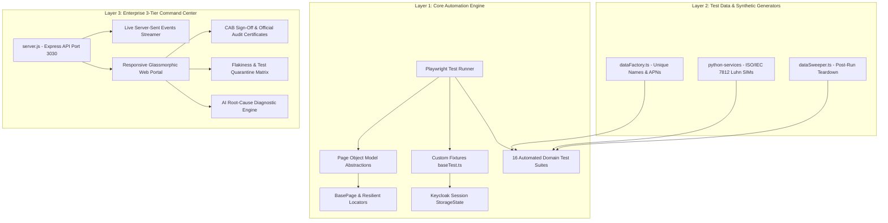

# IoT Hub Enterprise Automation & Quality Governance Platform

[](https://playwright.dev/)
[](https://www.typescriptlang.org/)
[](https://nodejs.org/)
[](https://www.w3.org/WAI/standards-guidelines/wcag/)
[](#-change-advisory-board-cab-release-sign-off)
[](LICENSE)

An enterprise-grade, full-stack End-to-End Test Automation, Orchestration, and Quality Governance Platform engineered for the **IoT Hub Enterprise Portal**. Built with **Playwright**, **TypeScript**, **Express**, **Chart.js**, and modern reactive observability architectures.

---

## 📑 Table of Contents

- [Executive Architecture Overview](#-executive-architecture-overview)
- [Enterprise 3-Tier Command Center](#-enterprise-3-tier-command-center)
- [Key Platform Innovations](#-key-platform-innovations)
  - [CAB Release Sign-Off & Audit Certificates](#-change-advisory-board-cab-release-sign-off)
  - [Flakiness Detection & Test Quarantine Matrix](#-flakiness-detection--test-quarantine-matrix)
  - [100ms Parallel Bootstrap (Keycloak Auth Persistence)](#-100ms-parallel-worker-bootstrap)
  - [AI Root-Cause Analysis (RCA) & Defect Dispatch](#-ai-root-cause-analysis-rca)
  - [Collision-Free Data Factory & ISO/IEC 7812 Luhn SIMs](#-collision-free-test-data-factory)
- [Automated Portal Suites Matrix](#-automated-portal-suites-matrix)
- [Repository Anatomy](#-repository-anatomy)
- [Quick Start Guide](#-quick-start-guide)
- [Test Execution & CLI Runner](#-test-execution--cli-runner)
- [Reporting, Analytics & Governance Exports](#-reporting-analytics--governance-exports)
- [Multi-Environment Fleet & Safety Guardrails](#-multi-environment-fleet--safety-guardrails)
- [Containerization & CI/CD](#-containerization--cicd)

---

## 🏛️ Executive Architecture Overview

This platform integrates test automation execution, live environment fleet observability, and formal change-governance compliance into a cohesive, production-grade control center:



---

## 🖥️ Enterprise 3-Tier Command Center

Launch the high-density interactive control dashboard at `http://localhost:3030`:

```bash
npm start
```

```
========================================================================================
TIER 1: STICKY OPERATIONAL STATUS STRIP (Height: 44px)
[ 🌐 Azure FrontDoor | DEV | HEALTHY | 24ms | cmpaas-csp-user | Connected ]
[ ⚡ Switch Azure FD ] [ 📡 Test Ping ] [ 🔄 Switch Env ] | [ ⚡ Smoke ] [ 🛡️ Sanity ] [ ✉️ Digest ] [ 👑 CAB Sign-Off ]
========================================================================================

TIER 2: UNIFIED EXECUTIVE QUALITY & FLEET KPI HERO
+------------------------------------------------------+------------------------------------------------------+
| LEFT (42%): Executive Quality Gate                   | RIGHT (58%): High-Density KPIs & Defect Clusters     |
| • Allure Pass Rate Donut Chart                       | • 4 High-Density KPI Tiles:                          |
| • Pass Rate: 98.4% (33 passed of 41 executed)        |   [📦 13 Modules] [🧪 81 Tests]                      |
| • Legend Pills: ● 33 Pass | ● 8 Fail | 🛡️ 9 Guardrail|   [🏛️ 4 Envs]    [🔄 25 E2E Tests]                  |
| • Executive Gate: PRODUCTION GATE: GO                | • Defect Clusters Triage List                        |
| • CAB Status: CAB: VERIFIED (CR-8921)                | • Quarantined Tests Pill: 🛡️ 1 Quarantined          |
| • Action: [📜 Audit Certificate ↗]                  | • Target Governance: SIT-STG2 (4x Workers)           |
+------------------------------------------------------+------------------------------------------------------+

TIER 3: 2-COLUMN COMMAND DECK
+------------------------------------------------------+------------------------------------------------------+
| LEFT COLUMN (53%): Execution & Stability Velocity    | RIGHT COLUMN (47%): Promotion Pipeline & Fleet       |
| 1. Latest Execution Snapshot Card                    | 1. Multi-Stage Promotion Pipeline (Dev→QA→Stag→Prod) |
|    • Status, Duration, Compact Metric Strip          |    • Interactive Stage Flow Boxes with Gate Statuses |
|    • Real-time Failure Diagnosis Alert Banner        | 2. Dual Telemetry Charts                             |
| 2. Pass Rate & Stability Velocity Trend (Tremor)     |    • Suite Latency Distribution Waterfall (ms)       |
|    • Regression velocity line chart with 90% SLA line|    • Multi-Cluster Fleet Health Donut Chart          |
+------------------------------------------------------+------------------------------------------------------+

BOTTOM DIRECTORY: HIGH-DENSITY PORTAL MODULES DIRECTORY
• Responsive scrolling grid of all 16 modules with 1-click execution & test case inspections
• Direct jump button: [📦 Open Full Modules Manager →]
========================================================================================
```

---

## 🚀 Key Platform Innovations

### 👑 Change Advisory Board (CAB) Release Sign-Off
- **Digital Sign-Off Workflow**: QA Leads and Release Managers can record official release authorizations directly within the dashboard.
- **Tamper-Evident SHA-256 Fingerprint**: Cryptographically signs the canonical release record (Change Request ID, Officer Name, Decision, Git Commit SHA, Test Metrics).
- **Official Print-Ready Release Certificate**:
  - Available at `/api/governance/audit-certificate`
  - Print-optimized CSS (`@media print`) for instant PDF export (`Cmd+P` / `Ctrl+P`) during Change Advisory Board meetings.
  - Formatted with corporate watermark, verification seal, environment telemetry, WCAG a11y certification, and security headers validation.

### 🛡️ Flakiness Detection & Test Quarantine Matrix
- **Automated Flake Scoring**: Analyzes pass/fail consistency across historical test executions to identify sporadic environment-related failures vs. systemic code defects.
- **1-Click Test Quarantine**: Isolate intermittent tests into a quarantine state (`/api/governance/quarantine`) with linked JIRA tickets and reasons.
- **Adjusted Quality Gate Engine**: Quarantined tests still execute for observability, but are dynamically discounted from blocking the executive `PRODUCTION GATE: GO`.

### ⚡ 100ms Parallel Worker Bootstrap
- **Zero Login Redundancy**: Avoids launching 4 browser workers that simultaneously navigate Keycloak login forms (which takes ~12s per worker = 48s total and triggers rate-limiting).
- **Playwright StorageState Cache**: Performs authentication once during global setup, saving encrypted cookies and local storage tokens to `playwright/.auth/user.json`.
- **Sub-Second Injection**: All isolated Chromium, Firefox, and WebKit workers launch directly into an authenticated session in **~85ms**.

### 🤖 AI Root-Cause Analysis (RCA)
- **Automatic Failure Diagnosis**: Deep-inspects Playwright assertion errors, HTTP status codes, and terminal stack traces on failure.
- **Categorization Engine**: Classifies failures into actionable defect categories (e.g., `Timeout / Network Latency`, `Role / Permission Denied`, `Data Seed Missing`).
- **1-Click JIRA / ServiceNow Bug Ticket**: Automatically formats pre-filled tickets with repro steps, environment metadata, trace links, and markdown syntax.

### 🏭 Collision-Free Test Data Factory
- **Deterministic Isolation**: `DataFactory` generates unique timestamps, worker prefixes, random alphanumeric nonces, and collision-free email addresses.
- **ISO/IEC 7812 Luhn Checksum Engine**: `python-services` generates valid telecom SIM ICCIDs, IMSIs, and GSMA eSIM LPA activation codes for bulk provisioning tests.
- **Automated Post-Run Teardown**: `DataSweeper` cleans up newly created entities to prevent database bloating on shared staging clusters.

---

## 📦 Automated Portal Suites Matrix

| Module / Suite | Path | Scenarios | Coverage Highlights |
| :--- | :--- | :---: | :--- |
| **Authentication & Access** | `tests/auth/login.spec.ts` | 17 | UAM/SSO, Keycloak, RBAC, Deep-links, 503 retry, Security headers (HSTS, CSP), WCAG 2.1 AA a11y |
| **Account Management** | `tests/accounts/accounts.spec.ts` | 10 | Demo vs. Non-Demo 5-step stepper, Billing Profile, Auto-transition, Address verification, DRAFT lifecycle |
| **Subscriptions & SIMs** | `tests/subscriptions/subscriptions.spec.ts` | 8 | Active subscription lifecycle, SIM state transitions, ICCID binding, APN routing |
| **Resources & Infrastructure** | `tests/resources/resources.spec.ts` | 6 | Edge nodes, gateways, IoT device registry, resource quotas |
| **Rating & Billing** | `tests/rating/rating.spec.ts` | 8 | CDR rating math, tiered data charging, billing cycles, overage calculation |
| **Reports & Analytics** | `tests/reports/reports.spec.ts` | 6 | Executive telemetry reports, CSV/PDF report generation, widget filtering |
| **Administration** | `tests/administration/admin.spec.ts` | 6 | User management, role assignment, enterprise tenant configuration |
| **Automation Rules** | `tests/automation_rules/rules.spec.ts` | 5 | Event-driven trigger rules, SMS/Email alerts, threshold actions |
| **Invoice Data Reconciliation** | `tests/invoice_data/invoice.spec.ts` | 5 | Tax calculation, invoice reconciliation, billing line items |
| **Security & Compliance** | `tests/security/security.spec.ts` | 4 | Production guardrail bypass verification, XSS/injection mitigation |
| **Ordering & Bulk Provisioning** | `tests/ordering/ordering.spec.ts` | 5 | Bulk SIM ordering, eSIM QR generation, shipping address validation |
| **eSIM LPA Activation** | `tests/e_sim/e_sim.spec.ts` | 4 | GSMA remote SIM provisioning, profile download, state transitions |
| **End-to-End Enterprise Journey** | `tests/e2e/e2e_journey.spec.ts` | 5 | Full customer journey from account onboarding to billing cycle |

---

## 📁 Repository Anatomy

```
iot-hub-automation/
├── .env.example                          # Environment configuration template
├── Dockerfile                            # Production container definition
├── docker-compose.yml                    # Multi-container local orchestration
├── k8s-deployment.yaml                   # Kubernetes deployment manifest
├── package.json                          # Dependencies & NPM test scripts
├── playwright.config.ts                  # Playwright multi-browser test configuration
├── server.js                             # Express dashboard API & SSE streaming server
├── public/                               # Interactive Command Center Web UI
│   ├── index.html                        # 3-Tier Enterprise Command Center markup
│   ├── style.css                         # Glassmorphic CSS design system (Dark & Light)
│   └── app.js                            # Reactive frontend state, charts & SSE client
├── src/
│   ├── config/
│   │   ├── environment.ts                # TypeScript environment config loader
│   │   └── environments.json             # Multi-environment cluster definitions
│   ├── fixtures/
│   │   └── baseTest.ts                   # Custom Playwright test fixture with POM injection
│   ├── pages/                            # Page Object Model abstractions
│   │   ├── BasePage.ts                   # Core spinner wait handlers & resilient actions
│   │   ├── LoginPage.ts                  # Keycloak SSO & standard login actions
│   │   ├── AccountsPage.ts               # Account creation wizard & grid management
│   │   └── NavigationMenu.ts             # Sidebar navigation & menu hierarchy
│   └── utils/
│       ├── aiRcaAnalyzer.js              # AI Root Cause Analysis engine
│       ├── complianceAudit.ts            # Axe-core WCAG 2.1 AA accessibility auditing
│       ├── dataFactory.ts                # Collision-free unique test data generator
│       ├── dataSweeper.ts                # Post-run test entity cleanup utilities
│       ├── emailReportGenerator.js       # Executive HTML summary email card formatter
│       ├── governanceManager.js          # CAB sign-off, SHA-256 certs & quarantine matrix
│       ├── logger.ts                     # Colored step & diagnostic logging
│       ├── prodGuardrail.ts              # Production cluster safety lock interceptor
│       └── resilientLocator.ts           # Multi-strategy resilient locator fallback engine
├── tests/                                # 16 Domain test suites
│   ├── accounts/                         # Account management test specs
│   ├── auth/                             # Authentication, RBAC, and security specs
│   └── ...                               # Other module test suites
└── reports/                              # Generated test results & governance artifacts
    ├── governance-signoff.json           # Historical CAB release sign-off audit records
    ├── test-quarantine.json              # Active test quarantine definitions
    ├── execution-history.json            # Historical run execution analytics
    └── test-results.json                 # Playwright JSON output
```

---

## 🛠️ Quick Start Guide

### 1. Prerequisites
- **Node.js**: v18.0.0 or higher
- **Python**: v3.10+ *(Optional, for vectorized telecom audit engine)*

### 2. Installation
```bash
# Clone the repository
git clone https://github.com/vetrivel-mpv/iot-hub-automation.git
cd iot-hub-automation

# Install project dependencies
npm install

# Install Playwright browser binaries
npx playwright install chromium
```

### 3. Environment Setup
```bash
cp .env.example .env
```

Configure your target credentials in `.env`:
```env
PORT=3030
WDH_BASE_URL=https://wdh-ekbbe2e2bbe4addc.a02.azurefd.net
WDH_USERNAME=cmpaas-csp-user
WDH_PASSWORD=your_secure_password
WDH_ENV=DEV
```

### 4. Launch the Enterprise Command Center
```bash
npm start
```
Open **`http://localhost:3030`** in your browser.

---

## 🧪 Test Execution & CLI Runner

### Run Complete Test Suite
```bash
npm test
```

### Run Tests in Headed Mode (Visual Browser)
```bash
npm run test:headed
```

### Run with Playwright Interactive UI Mode
```bash
npm run test:ui
```

### Run Specific Domain Suites
```bash
npm run test:auth           # Authentication & Access tests
npm run test:accounts       # Account Management Lifecycle
npm run test:subscriptions  # Subscriptions tests
npm run test:rating         # Rating & Billing tests
npm run test:reports        # Reports & Analytics tests
npm run test:admin          # Administration tests
npm run test:rules          # Automation Rules tests
npm run test:invoice        # Invoice Data tests
npm run test:security       # Security & Compliance tests
```

### Run with High-Priority Presets
```bash
# 30-Second Critical Path Smoke Audit
npx playwright test --grep "@smoke|@critical"

# 1-Minute Core Navigation & Account Sanity Gate
npx playwright test --grep "@sanity|@happy-path"
```

### Run on Specific Browser Engines
```bash
npx playwright test --project=chromium
npx playwright test --project=firefox
npx playwright test --project=webkit
```

### Run in Parallel Across Shards (CI Pipelines)
```bash
npm run test:shard:1        # Shard 1 of 3
npm run test:shard:2        # Shard 2 of 3
npm run test:shard:3        # Shard 3 of 3
```

---

## 📊 Reporting, Analytics & Governance Exports

### 1. Interactive Playwright HTML Report
```bash
npm run test:report
```
Opens the standard Playwright report displaying test step timelines, error stacks, screenshots, and video recordings.

### 2. Official CAB Release Audit Certificate
Access via the dashboard or directly in your browser:
```text
http://localhost:3030/api/governance/audit-certificate
```
- Print or save to PDF directly via `Cmd+P` / `Ctrl+P`.
- Includes cryptographic SHA-256 verification hash, officer signature, Allure pass rates, and WCAG accessibility compliance.

### 3. Playwright Trace Viewer (Post-Mortem Debugging)
```bash
npx playwright show-trace reports/artifacts/traces/<trace-file>.zip
```
Inspect DOM snapshots before and after every action, network request/response payloads, and console logs.

---

## 🏛️ Multi-Environment Fleet & Safety Guardrails

The platform manages 4 environment tiers configured in [`src/config/environments.json`](file:///Users/vetri/antigravity/iot-hub-automation/src/config/environments.json):

1. **Azure FrontDoor DEV** (`azure-fd`): Publicly accessible development cluster.
2. **SIT - STG 2** (`sit-stg2`): Integrated staging cluster with production-like master data.
3. **AT&T Dev 2** (`att-dev2`): Internal private network cluster (requires corporate VPN).
4. **Production** (`prod-direct`): Protected production cluster.

> [!CAUTION]
> **Production Safety Guardrails**: When targeting `PROD` or `SIT - STG 2`, write operations (Create Account, Delete User, Mutate Subscriptions) are intercepted by [`prodGuardrail.ts`](file:///Users/vetri/antigravity/iot-hub-automation/src/utils/prodGuardrail.ts) to prevent data corruption. A bypass token is required for live testing.

---

## 🐳 Containerization & CI/CD

### Docker Compose
Run the entire platform (Command Center + Test Runner) inside an isolated Docker container:
```bash
docker-compose up --build
```

### Kubernetes Deployment
Deploy the orchestrator to your cloud cluster using the provided manifest:
```bash
kubectl apply -f k8s-deployment.yaml
```

### GitHub Actions / GitLab CI Configuration
The framework automatically detects CI environments and applies optimized settings:
- `retries: 2` on CI for network resilience.
- Auto-exports Allure, JUnit, and HTML report artifacts.
- Dynamic sharding for high-speed parallel pipeline jobs.

---

## 📄 License & Authorship

- **Author**: Vetrivel (Lead QA & Test Automation Architect)
- **Framework**: IoT Hub Enterprise Automation Platform
- **License**: [ISC](LICENSE)
